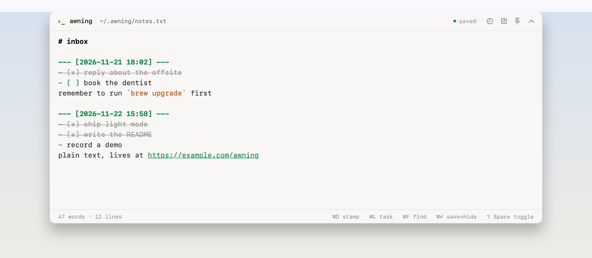
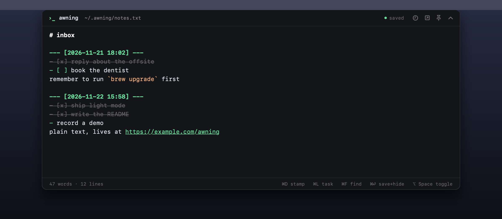

# Awning

A drop-down scratchpad for macOS, in the style of the Quake console.

Press **⌥ Space** anywhere and a notepad slides down from under the menu bar. Jot something down, press **esc**, and you're back where you were. Your notes are one plain-text file: `~/.awning/notes.txt`.

<picture>
  <source media="(prefers-color-scheme: dark)" srcset="docs/hero-dark.png">
  
</picture>

## Why

- **Always one keystroke away.** It opens over any app, on every desktop and over full-screen windows, without taking focus away from the app you were in.
- **Just a text file.** No database, no account, no sync service. Read it with `cat`, append to it with `echo`, put it in git or Dropbox.
- **Small and fast.** Native Swift and AppKit, no dependencies, under 500 KB. Typing takes a couple of milliseconds per keystroke even in a 1 MB notes file.
- **No permissions needed.** The global hotkey doesn't require Accessibility or Input Monitoring access.

## Demo


Opening the visor, adding a timestamp (⌘D), typing a list that continues itself on Return, turning items into checkboxes and ticking them off (⌘L), then hiding it again. ([MP4 version](docs/demo.mp4))

## Install

You need macOS 13 or later and Xcode 15 or later (or the matching Swift toolchain).

```bash
git clone <this repository>
cd awning
./build.sh install
```

This builds the app, copies it to `/Applications` and launches it. On the very first launch the visor drops down on its own so you can see it's working. After that, it lives in the menu bar (the text-lines icon).

To start it automatically, right-click the menu bar icon and turn on **Launch at Login**.

## Using it

| Keys | Action |
| :--- | :--- |
| <kbd>⌥ Space</kbd> | Show or hide the visor (you can change this) |
| <kbd>esc</kbd> or <kbd>⌘W</kbd> | Hide |
| <kbd>⌘⏎</kbd> | Save and hide |
| <kbd>⌘D</kbd> | Insert a timestamp line: `--- [2026-11-22 09:30] ---` |
| <kbd>⌘L</kbd> | Checkbox on the current line(s): `idea` → `- [ ] idea` → `- [x] idea` |
| <kbd>⏎</kbd> on a list line | Continue the list (`-`, `*`, `1.`, `- [ ]`, `>`). On an empty item, end the list |
| <kbd>Tab</kbd> / <kbd>⇧Tab</kbd> | Indent / outdent by two spaces; works on several selected lines |
| <kbd>⌘F</kbd>, <kbd>⌘G</kbd>, <kbd>⇧⌘G</kbd>, <kbd>⌘E</kbd> | Find, next, previous, find the selection |
| <kbd>⌘+</kbd>, <kbd>⌘-</kbd>, <kbd>⌘0</kbd> | Bigger, smaller, default text size |
| <kbd>⌘S</kbd> | Save now (it saves on its own anyway) |
| <kbd>⌘O</kbd> | Open the file in your default text editor |
| <kbd>⌘Q</kbd> | Quit |

Clicking outside the visor or switching apps hides it. The pin button in the header keeps it open instead, which is handy when copying from another window. Drag the bottom edge to change the height.

Notes are plain text, but a few things are styled as you type: `#` headings, timestamp lines, list markers and checkboxes (done items are struck through), `` `inline code` `` and `https://` links, which you can click.

## Settings

Right-click (or ⌥/⌃-click) the menu bar icon:

- **Hotkey:** ⌥ Space, ⌃ \`, ⌥ \`, ⇧⌘ Space or ⌥⌘ N. If another app already uses the one you pick, Awning tells you and the menu bar icon shows a warning.
- **Appearance:** Match System (default), Light or Dark.

   
- **Choose Notes File…:** edit any other text file instead, e.g. one inside a synced folder.
- **Keep Open When Unfocused** and **Launch at Login.**

Height and text size are remembered too.

## Your notes file

```
~/.awning/
  notes.txt        your notes
  conflicts/       backups from edit conflicts (only created if one happens)
```

Awning is careful with this file:

- **It saves continuously:** 0.4 s after you stop typing, at least every 3 s while you keep typing, and whenever you hide the visor, quit, or the Mac sleeps or shuts down.
- **Adding text only appends.** If you only added to the end, only the new text is written, so `tail -f ~/.awning/notes.txt` keeps working. Any other edit is written to a temporary file and swapped in, so a crash never leaves a half-written file.
- **Changes from other programs show up live.** Try `echo "call mum" >> ~/.awning/notes.txt` with the visor open, even mid-sentence.
- **Conflicts never lose anything.** If another program rewrites the file in the few seconds before your typing is saved, your version is kept and the other one is saved in `~/.awning/conflicts/`. The status line tells you and links to it. This mostly matters if you sync the folder between Macs.
- **It won't damage files it can't read.** A file that isn't valid UTF-8 opens read-only instead of being overwritten.
- **Symlinks are followed.** Point `~/.awning` (or just `notes.txt`) into Dropbox, iCloud Drive or a git repository and it stays a link.

## Uninstall

Quit Awning from the menu bar, then:

```bash
rm -rf /Applications/Awning.app
defaults delete dev.awning.Awning   # preferences
rm -rf ~/.awning                    # your notes. Only if you're sure!
```

## Development

```bash
./build.sh          # build build/Awning.app
./build.sh run      # build and (re)launch
./build.sh test     # unit tests (same as: swift test)
UNIVERSAL=1 ./build.sh   # Apple silicon + Intel binary
```

It's a Swift package. The file handling, conflict logic and text editing helpers live in `AwningCore` with no AppKit dependency, so they're unit tested. The app target is the UI on top.

```
Sources/AwningCore/       pure logic, unit tested
  NoteFile.swift          read / append / atomic write, conflict backups
  SyncResolver.swift      what to do when the file and the editor disagree
  TextOps.swift           list continuation, checkboxes, indent, timestamps, word count
Sources/Awning/           the app
  AppDelegate.swift       menu bar icon and menu, hotkey, launch at login
  VisorController.swift   wires everything together; all visor shortcuts
  VisorPanel.swift        the drop-down window and its animation
  NoteSession.swift       unsaved-change tracking, autosave, syncing with the file
  FileWatcher.swift       notices outside changes, even if the file is replaced or deleted
  EditorView.swift        header, editor and footer layout
  NoteTextView.swift      editing behaviour (lists, tabs, timestamps)
  Highlighter.swift       styling, re-done only for the paragraph being edited
  Theme.swift             light and dark colours
  HotKey.swift            global hotkey (Carbon, so no permissions needed)
Tests/AwningCoreTests/
```

## License

[MIT](LICENSE)
